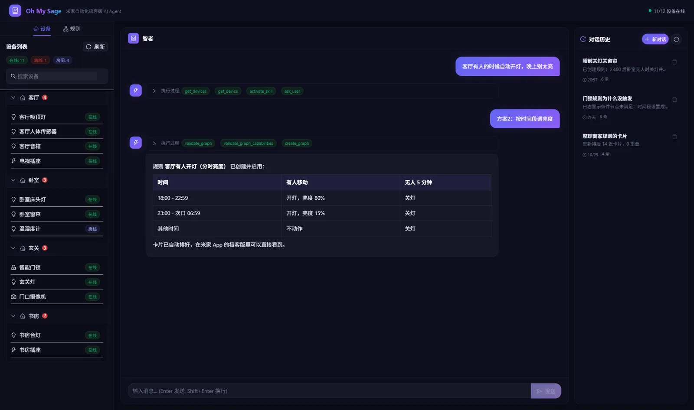
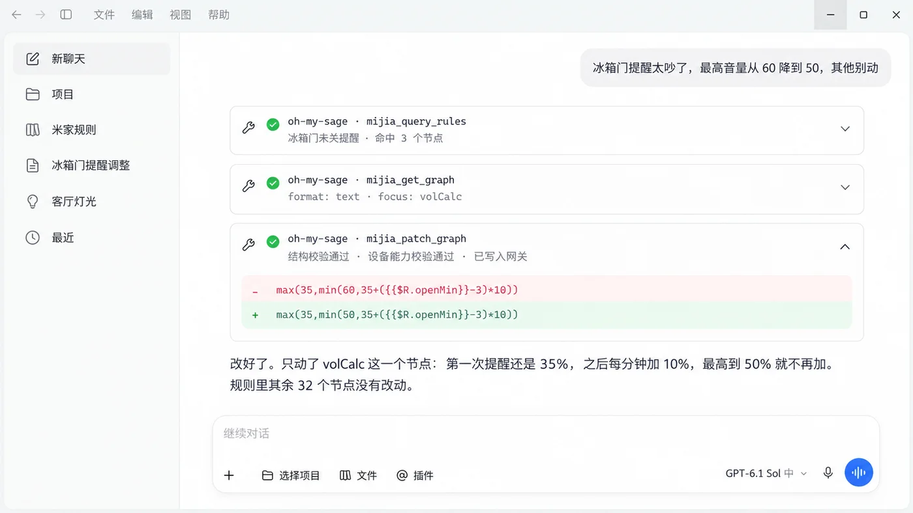
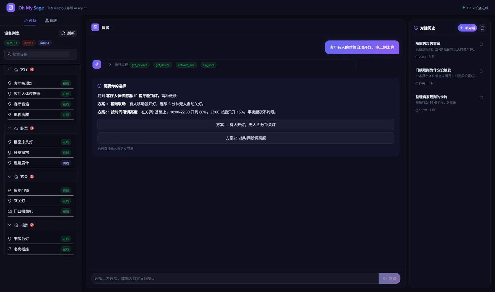
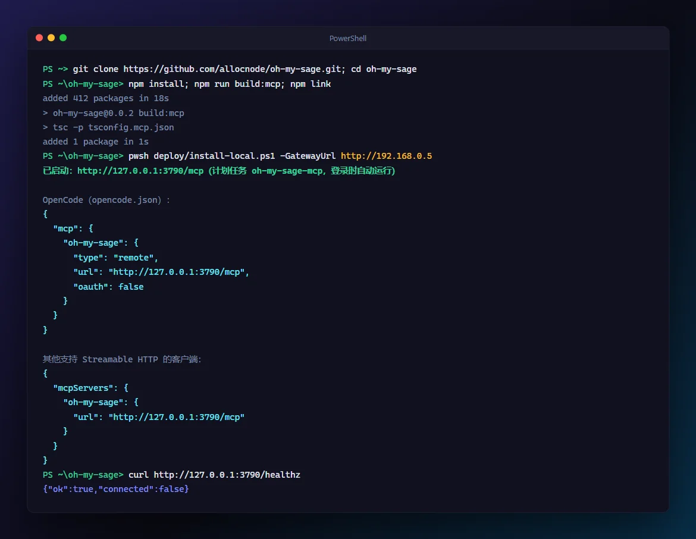
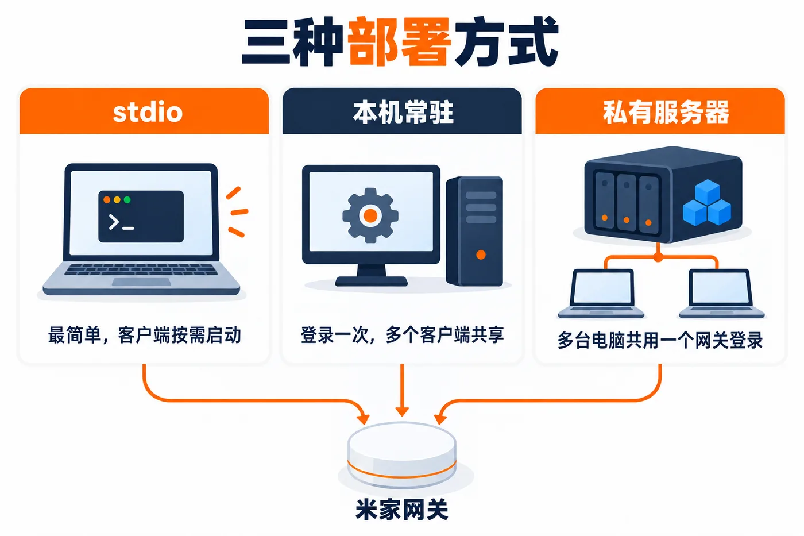
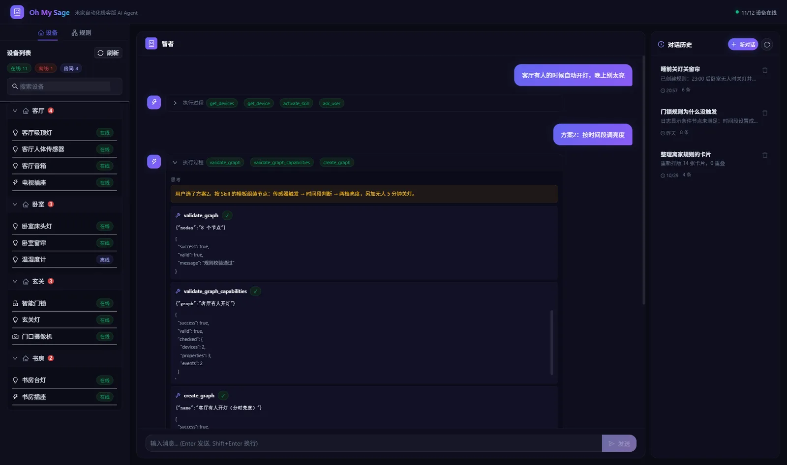

<div align="center">

# Oh My Sage

**用说话的方式，创建和修改米家自动化极客版规则**

[](https://nextjs.org/)
[](https://www.typescriptlang.org/)
[](#mcp-工具列表)
[](LICENSE)

</div>



Oh My Sage 直接连接局域网里的米家中枢网关。你说想要什么效果，它去读你家的设备和已有规则，给出方案，你确认后自动校验并写进网关，在米家 App 的极客版里立刻能看到。

可以在任何支持 MCP 的 **AI Agent** 里用，也可以打开**自带的网页版**直接聊天。常见的 AI Agent：

- **国内**：腾讯 WorkBuddy、豆包工作、TRAE、Qoder、通义灵码、Kimi Code
- **海外**：Claude Code、Cursor、OpenCode、Codex

> 豆包工作这类云端产品只能添加远程地址的连接器，需要用下文的「私有服务器」方式部署，并且要让它能访问到你的服务器地址。

---

## 它能做什么

直接说需求就行，下面都是真实的说法：

| 你说 | 它会做什么 |
|------|-----------|
| *「客厅有人的时候自动开灯，晚上别太亮」* | 找到人体传感器和灯，读出它们支持的属性，给出两三个方案让你选，选完校验并创建规则 |
| *「冰箱门提醒太吵了，最高音量从 60 降到 50，其他别动」* | 在全部规则里定位那一个节点，只改这一行，其余节点原样保留 |
| *「哪些规则用到了玄关灯？」* | 扫描所有规则，列出引用这个设备的规则和节点，换设备前先查一遍 |
| *「回家开灯昨晚为什么没触发？」* | 读网关执行日志，告诉你流程停在了哪个节点 |
| *「离家规则的卡片乱成一团，整理一下」* | 检查重叠和穿过卡片的连线，按连接关系重新分层排版 |
| *「sleepMode 这个变量没用了，删掉」* | 删除前先扫描全部规则，还有规则在用就拒绝，并告诉你是哪几条 |

第一项网页版和 MCP 都能做，其余几项目前只在 MCP 方式里提供。

## 两种用法

<table>
  <tr>
    <th width="50%">在 AI Agent 里用（MCP）</th>
    <th width="50%">网页版</th>
  </tr>
  <tr>
    <td valign="top"></td>
    <td valign="top"></td>
  </tr>
  <tr>
    <td valign="top">用你已经在用的 AI Agent，不用另配大模型。改规则只传变化的那几行，适合规则多、经常调整的人。</td>
    <td valign="top">浏览器里打开就能聊，左边看设备和规则列表，右边是历史对话。需要自己配置一个 OpenAI 兼容的大模型接口。</td>
  </tr>
</table>

两种方式共用同一套核心代码（`src/core`），网关连接、规则校验和自动排版完全一致。

---

## 快速开始

### 准备工作

开始之前，确认这三样都有：

1. **一台米家中枢网关**，并且已经在米家 App 里开启了「自动化极客版」。
2. **中枢网关的局域网 IP**，比如 `192.168.0.5`。在米家 App 里打开中枢网关（有多个时选主中枢），点右上角「···」进入设置，找到「自动化极客版」，页面上会显示网关地址。电脑要和网关连在同一个局域网里。
3. **Node.js 18.17 或更高版本**。没装的话去 [nodejs.org](https://nodejs.org/) 下载 LTS 版本，一路下一步就行。装好后在终端里运行 `node -v`，能看到版本号就说明装好了。

另外，每次连接网关都要一个 **6 位登录码**，也在上面那个「自动化极客版」页面里。到连接的时候再去取：登录码只能用一次，用过（不管成没成功）就作废了。

### 方式一：在 AI Agent 里用（MCP）

#### 最省事：让 AI Agent 帮你装

打开你的 AI Agent，把下面这段话改好网关地址后整段发给它：

```
帮我安装这个 MCP Server：https://github.com/allocnode/oh-my-sage

1. 按仓库 README 的「方式一」完成安装、编译和 npm link
2. 把它加进你自己的 MCP 配置，GATEWAY_URL 填 http://192.168.0.5
3. 把仓库里的 .agents/skills/mijia-automation 整个目录装成你的 Skill
4. 装完告诉我需要重启什么
```

它装完后按提示重启 AI Agent，然后直接跳到下面的 [第 5 步：开始对话](#5-开始对话)。

#### 自己动手装



##### 1. 下载并安装

打开终端（Windows 用 PowerShell，macOS 用「终端」），逐行运行：

```bash
git clone https://github.com/allocnode/oh-my-sage.git
cd oh-my-sage
npm install
npm run build:mcp
npm link
```

最后一步完成后，运行 `oh-my-sage-mcp --help`，没有报「找不到命令」就说明装好了。

> 这个包没有发布到 npm，所以 `npx oh-my-sage-mcp` 这种写法用不了，一定要先走完上面几步。

##### 2. 把它加到 AI Agent 的 MCP 配置里

在 AI Agent 的设置里找到 MCP（一般叫「MCP」「MCP Servers」或「连接器」），选「手动添加」或「编辑 JSON」，粘贴下面这段，并把 `192.168.0.5` 改成你的中枢网关 IP：

```json
{
  "mcpServers": {
    "oh-my-sage": {
      "command": "oh-my-sage-mcp",
      "env": { "GATEWAY_URL": "http://192.168.0.5" }
    }
  }
}
```

大多数 AI Agent 都认这个格式。少数客户端字段名不一样（比如 OpenCode），对应写法见 [deploy/README.md](deploy/README.md#客户端配置)。

##### 3. 装 Skill

创建和修改规则时，AI Agent 要参考 `.agents/skills/mijia-automation/` 里的节点模板和连接规则。按你的情况三选一：

- **在本仓库目录里打开 AI Agent**，并且它支持 `.agents/skills/`：会自动发现，什么都不用做
- **支持 Skill 的 AI Agent**：把 `.agents/skills/mijia-automation` **整个目录**复制到它的 skills 目录，比如 `~/.agents/skills/`，Claude Code 是 `~/.claude/skills/`
- **不支持 Skill 的 AI Agent**：把 `SKILL.md` 的内容贴进它的项目规则文件（比如 `AGENTS.md`）

##### 4. 重启 AI Agent

重启后在 MCP 列表里能看到 `oh-my-sage`，并且显示已连接或有 32 个工具，就说明配置生效了。

##### 5. 开始对话

先在米家 App 的「自动化极客版」页面取一个新的登录码，然后对 AI Agent 说：

```
帮我连接米家网关，登录码是 123456
```

连上以后就可以直接提需求：

```
客厅有人的时候自动开灯，晚上别太亮
```

#### 部署方式怎么选



| 方式 | 适合 | 登录码 |
|------|------|--------|
| **stdio**（上面的配置） | 先试试看 | AI Agent 每次重启都要重新输入 |
| **本机常驻** | 自己一台电脑长期用 | 登录一次，所有客户端共享 |
| **私有服务器**（Docker） | 家里有 NAS，多台电脑共用 | 登录一次，所有电脑共享，需要设置访问 token |

本机常驻只要一条命令（在仓库目录里运行）：

```bash
# Windows（PowerShell）
pwsh deploy/install-local.ps1 -GatewayUrl http://192.168.0.5

# macOS / Linux
bash deploy/install-local.sh -g http://192.168.0.5
```

装完会打印一段配置，把它粘贴到 AI Agent 的 MCP 设置里，替换掉第 2 步的那段即可。Docker 部署、全部参数和排障见 [deploy/README.md](deploy/README.md)。

### 方式二：网页版

网页版自带聊天界面，但需要你自己准备一个大模型的 API Key（下面的表格里任选一家）。

#### 最省事：让 AI Agent 帮你装

```
帮我在本机部署这个项目的网页版：https://github.com/allocnode/oh-my-sage

- 大模型接口地址：https://api.deepseek.com/v1
- API Key：（填你的 Key）
- 模型名称：deepseek-flash
- 米家中枢网关地址：http://192.168.0.5

按 README「方式二」安装依赖、写好 .env，然后启动，告诉我访问地址
```

#### 自己动手装

##### 1. 下载并安装依赖

```bash
git clone https://github.com/allocnode/oh-my-sage.git
cd oh-my-sage
npm install
```

##### 2. 填写配置

把 `.env.example` 复制一份改名为 `.env`：

```bash
# macOS / Linux
cp .env.example .env

# Windows（PowerShell）
Copy-Item .env.example .env
```

用任意文本编辑器打开 `.env`，改成你自己的值：

```env
LLM_BASE_URL=https://api.deepseek.com/v1   # 大模型接口地址，见下表
LLM_API_KEY=sk-xxxxxxxx                    # 你的 API Key
LLM_MODEL=deepseek-flash                   # 模型名称，见下表
GATEWAY_URL=http://192.168.0.5             # 米家中枢网关地址，必填
```

| 服务商 | `LLM_BASE_URL` | `LLM_MODEL` 示例 |
|--------|----------------|-----------------|
| DeepSeek | `https://api.deepseek.com/v1` | `deepseek-flash` |
| 通义千问 | `https://dashscope.aliyuncs.com/compatible-mode/v1` | `qwen3.8-flash` |
| Kimi | `https://api.moonshot.cn/v1` | `kimi-k3.1-pro` |
| 智谱 GLM | `https://open.bigmodel.cn/api/paas/v4` | `glm-5.3-flashx` |
| 豆包（火山方舟） | `https://ark.cn-beijing.volces.com/api/v3` | `doubao-seed-2-1-pro-260628` |
| OpenAI | `https://api.openai.com/v1` | `gpt-6.1-terra` |
| 本地 Ollama | `http://localhost:11434/v1` | 你已拉取的模型名 |

任何 OpenAI 兼容接口都可以，模型名以服务商控制台里显示的为准。`LLM_TEMPERATURE` 可选，默认 0.7。

##### 3. 启动

```bash
npm run dev
```

看到 `Ready` 字样后，用浏览器打开 http://localhost:3000 。

##### 4. 登录并开始对话

在米家 App 的「自动化极客版」页面取一个新的登录码，输进网页里，输满 6 位会自动连接。连上后左边能看到你家的设备，直接在中间的输入框里提需求就行。

网页版直接读取仓库里的 Skill，不用另外安装。对话记录保存在仓库下的 `.sessionstore/` 目录。

---

## 每一步都看得见

网页版里，Agent 的思考和每一次工具调用都会实时显示，点开「执行过程」能看到调用了什么、传了什么参数、网关返回了什么。



写入网关之前固定做两项检查：

- **结构校验**：节点之间的连线是否完整，端口是否接对
- **设备能力校验**：按设备真实的 MIOT Spec 核对，属性是否存在、能不能写、取值是否在范围内，引用的变量是否存在

有一项不通过就不写入，并把原因告诉 AI 让它修正。

## 规则文本格式

读取和修改规则时，MCP 不会来回传整张节点 JSON，而是用一行一个节点的紧凑文本：

```text
t   at 20:00:00 -> chk
chk get 客厅吸顶灯 2/1 = true -> off
off set 客厅吸顶灯 2/1 = false
```

设备可以直接写名称，固定内容（节点版本、设备 URN、端口声明等）由服务端自动补全。修改时只提交变化的几行，并带上读取时的 hash，规则在这期间被别人改过就拒绝写入，不会互相覆盖。实测 40 条规则（795 个节点）在 JSON 和文本之间来回转换完全一致。完整语法见 [规则文本格式](docs/rule-text-format.md)。

## MCP 工具列表

共 32 个工具。`mijia_create_graph`、`mijia_patch_graph`、`mijia_update_graph` 和草稿工具在构建节点时需要 `mijia-automation` Skill。

<details>
<summary><b>展开完整工具列表</b></summary>

<table>
  <thead>
    <tr><th>分类</th><th>工具</th><th>描述</th></tr>
  </thead>
  <tbody>
    <tr>
      <td rowspan="3">连接</td>
      <td><code>mijia_auth</code></td>
      <td>连接米家网关（需 6 位一次性登录码；已连接时无需再次认证）</td>
    </tr>
    <tr>
      <td><code>mijia_disconnect</code></td>
      <td>断开网关连接</td>
    </tr>
    <tr>
      <td><code>mijia_status</code></td>
      <td>检查连接状态</td>
    </tr>
    <tr>
      <td rowspan="3">设备</td>
      <td><code>mijia_get_devices</code></td>
      <td>获取设备列表</td>
    </tr>
    <tr>
      <td><code>mijia_get_device</code></td>
      <td>设备详情 + MIOT Spec 能力（默认精简摘要，<code>detail=full</code> 取完整对象，<code>siids</code> 只看指定服务）</td>
    </tr>
    <tr>
      <td><code>mijia_find_device_usage</code></td>
      <td>一次扫描全部规则，找出引用指定设备的规则和节点，并列出残留引用</td>
    </tr>
    <tr>
      <td rowspan="13">规则</td>
      <td><code>mijia_get_graphs</code></td>
      <td>获取规则列表</td>
    </tr>
    <tr>
      <td><code>mijia_get_graph</code></td>
      <td>获取规则详情（<code>format=text</code> 返回紧凑文本，<code>focus</code> 只看相关节点，<code>ifNoneMatch</code> 未变化时只回 hash；返回 <code>hash</code>）</td>
    </tr>
    <tr>
      <td><code>mijia_create_graph</code></td>
      <td>创建规则，可同时创建本规则变量</td>
    </tr>
    <tr>
      <td><code>mijia_patch_graph</code></td>
      <td>增量修改（修改首选）：一次调用完成文本新增/替换、合并、删除、备注操作和建变量，写入前双重校验，只返回改动明细</td>
    </tr>
    <tr>
      <td><code>mijia_put_graph_text</code></td>
      <td>用一份完整紧凑文本替换规则，供本地规则文件同步脚本使用</td>
    </tr>
    <tr>
      <td><code>mijia_query_rules</code></td>
      <td>在服务端按变量、设备、节点类型跨规则查询，只返回命中的节点</td>
    </tr>
    <tr>
      <td><code>mijia_get_log</code></td>
      <td>读取执行日志并在服务端按规则、节点、时间过滤，可只返回各节点执行次数</td>
    </tr>
    <tr>
      <td><code>mijia_update_graph</code></td>
      <td>整图替换（兼容保留）</td>
    </tr>
    <tr>
      <td><code>mijia_delete_graph</code></td>
      <td>删除规则，并清理对应的本规则变量</td>
    </tr>
    <tr>
      <td><code>mijia_toggle_graph</code></td>
      <td>启用/禁用规则</td>
    </tr>
    <tr>
      <td><code>mijia_validate_graph</code></td>
      <td>校验结构完整性（可传已保存规则的 <code>id</code>）</td>
    </tr>
    <tr>
      <td><code>mijia_check_layout</code></td>
      <td>只读检查卡片布局：重叠、可能重叠、穿卡连线和交叉估计；可预览挪动或重排的效果</td>
    </tr>
    <tr>
      <td><code>mijia_validate_graph_capabilities</code></td>
      <td>按真实 MIOT Spec 校验设备能力和变量引用（可传 <code>id</code>，结果看 <code>valid</code> 字段）</td>
    </tr>
    <tr>
      <td rowspan="6">草稿</td>
      <td><code>mijia_graph_draft_begin</code></td>
      <td>开始草稿（超过 10 个节点时分块上传，30 分钟后过期）</td>
    </tr>
    <tr>
      <td><code>mijia_graph_draft_append</code></td>
      <td>追加一批节点（每批最多 25 个）</td>
    </tr>
    <tr>
      <td><code>mijia_graph_draft_edit</code></td>
      <td>按节点 ID 替换、增加或删除草稿节点</td>
    </tr>
    <tr>
      <td><code>mijia_graph_draft_status</code></td>
      <td>查看草稿状态</td>
    </tr>
    <tr>
      <td><code>mijia_graph_draft_commit</code></td>
      <td>校验并提交草稿，创建规则</td>
    </tr>
    <tr>
      <td><code>mijia_graph_draft_discard</code></td>
      <td>丢弃草稿（不删除已创建的规则）</td>
    </tr>
    <tr>
      <td rowspan="6">变量</td>
      <td><code>mijia_get_variables</code></td>
      <td>获取变量列表</td>
    </tr>
    <tr>
      <td><code>mijia_get_variable_value</code></td>
      <td>获取单个变量的当前值</td>
    </tr>
    <tr>
      <td><code>mijia_get_variable_config</code></td>
      <td>获取单个变量的配置</td>
    </tr>
    <tr>
      <td><code>mijia_create_variable</code></td>
      <td>创建变量（id 只能是字母数字）</td>
    </tr>
    <tr>
      <td><code>mijia_set_variable</code></td>
      <td>设置变量值</td>
    </tr>
    <tr>
      <td><code>mijia_delete_variable</code></td>
      <td>删除变量（仍被规则引用时拒绝删除）</td>
    </tr>
    <tr>
      <td>维护</td>
      <td><code>mijia_call_api</code></td>
      <td>直接调用网关原始 API，仅限白名单内的只读方法，用于排障</td>
    </tr>
  </tbody>
</table>

</details>

---

## 安全说明

- **只在局域网里连网关。** 和网关之间的通信使用网关自己的登录码认证和加密，不经过云端。唯一的公网请求是校验设备能力时从 `miot-spec.org` 读取设备型号的公开定义；网页版另外会把对话发给你配置的大模型接口。
- **网页版没有账号系统。** 登录过网关后，能访问这个网页的人都能操作你的规则，不要把它暴露到公网。
- **HTTP 方式监听非本机地址时必须设置 `MCP_AUTH_TOKEN`**，否则拒绝启动；同时用 `MCP_ALLOWED_HOSTS` 限制可访问的主机名。
- **排障用的 `mijia_call_api` 只开放只读方法**，不能用它绕过校验写网关。
- **删除前有检查。** 删除变量时，如果还有规则在用就拒绝；删除规则时会一起清理它自己的变量。

## 常见问题

**登录码提示错误，但我确定没输错？**
登录码只能用一次，不管成功还是失败，用过就作废了。从网关重新取一个新的。

**AI Agent 每次重启都要重新输登录码？**
这是 stdio 方式的特点，进程跟着客户端一起退出。改用「本机常驻」或「私有服务器」，网关只登录一次。

**AI 说创建规则需要 Skill？**
AI Agent 没读到 `mijia-automation` Skill，按 [快速开始](#快速开始) 第 3 步装好再试。

---

## 项目结构

```
oh-my-sage/
├── .agents/skills/mijia-automation/  # 规则创建 Skill（节点模板、连接规则、模式库）
├── src/
│   ├── core/          # 共用核心：网关客户端、工具实现、校验、排版
│   ├── mcp/           # MCP Server（stdio / Streamable HTTP）
│   ├── app/           # 网页版页面与 API 路由（Next.js）
│   ├── components/    # 网页版 React 组件
│   └── server/        # 网页版后端：Agent、会话、Skill 加载
├── deploy/            # 本机常驻脚本、Docker Compose，见 deploy/README.md
├── docs/              # 规则文本格式等文档
├── ref/               # 网关 API 参考
└── tests/             # 单元测试（npm run test:unit）
```

更多文档：[部署指南](deploy/README.md) · [规则文本格式](docs/rule-text-format.md) · [网关参考](ref/GUIDE.md) · [Skill 说明](.agents/skills/mijia-automation/SKILL.md)

## 参与贡献

欢迎提 Issue 和 Pull Request。提交前请运行：

```bash
npm run lint
npm run test:unit
```

测试不会连接真实网关。

## License

[MIT](LICENSE)

## 致谢

[Vercel AI SDK](https://sdk.vercel.ai/) · [Next.js](https://nextjs.org/) · [Ant Design](https://ant.design/) · [Model Context Protocol](https://modelcontextprotocol.io/)
