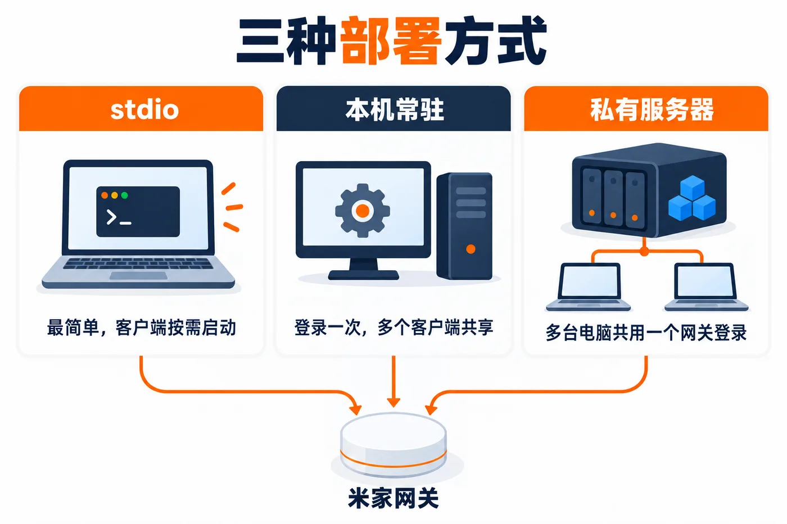

# 部署

oh-my-sage 的 MCP Server 有三种部署方式，工具和功能完全相同，区别只在于进程跑在哪里。



| 方式 | 进程位置 | 特点 |
|------|----------|------|
| **stdio（默认）** | 由 AI Agent 按需启动 | 最简单，零额外进程；客户端重启后需重新输入登录码 |
| **本机常驻** | 本机后台服务，仅监听 `127.0.0.1` | 登录一次网关，多个客户端共享，重开客户端无需再输登录码 |
| **私有服务器** | NAS / 家庭服务器上的 Docker | 同上，多台电脑共用一个网关登录；需设置访问 token |

后两种走 Streamable HTTP（`/mcp`）：进程常驻，请求不经过 stdio 路径，因此并发工具调用较多时也不会刷 `MaxListenersExceededWarning`（该告警来自 MCP SDK stdio 客户端为每个并发请求在流上挂 `drain` 监听器，属于日志噪音，不影响工具执行结果）。无论用哪种方式，客户端都不需要额外处理这个告警。

改完部署方式后，客户端配置见下文 [客户端配置](#客户端配置)。下文命令和配置里的 `<网关 IP>`、`<服务器 IP>`、`<访问密码>` 都是占位符，换成你自己的值，尖括号不要保留。

---

## 方式一：stdio

由客户端按需拉起进程，无需部署脚本，安装命令见 [主 README](../README.md#安装)。客户端不在 `add-mcp` 支持列表里时，手动写法见下文 [客户端配置](#客户端配置)；不支持 Skill 的客户端，把 [SKILL.md](../.agents/skills/mijia-automation/SKILL.md) 的内容贴进它的规则文件（如 `AGENTS.md`）。

`npx -y oh-my-sage-mcp` 不带版本号时，每次启动都会向 npm 查询最新版，有新版本就自动换上，不需要手动升级。想固定版本，写成 `oh-my-sage-mcp@<版本号>`，可用版本见 [npm](https://www.npmjs.com/package/oh-my-sage-mcp?activeTab=versions)。

---

## 方式二：本机常驻

注册为当前用户登录时自动启动的后台服务，只监听回环地址，默认端口 `3790`。安装脚本随 npm 包一起发布，先全局安装：

```bash
npm install -g oh-my-sage-mcp
```

下面命令里的 `$(npm root -g)/oh-my-sage-mcp` 是全局安装目录。服务直接运行这个目录里的代码，升级时重新 `npm install -g oh-my-sage-mcp`，再运行一次安装脚本让服务重启。

从仓库源码安装（开发用）：在仓库根目录执行 `npm run build:mcp`，再把命令里的路径换成仓库里的 `deploy/`。

### macOS / Linux

```bash
bash "$(npm root -g)/oh-my-sage-mcp/deploy/install-local.sh" -g "http://<网关 IP>"
```

| 参数 | 说明 |
|------|------|
| `-g, --gateway` | 网关地址；不填则首次调用 `mijia_auth` 时需传 `gateway_url` |
| `-p, --port` | 监听端口，默认 `3790` |
| `-t, --token` | Bearer token，回环地址可不设 |
| `-n, --name` | 服务名，默认 `oh-my-sage-mcp` |
| `-u, --uninstall` | 卸载服务 |

- macOS 注册为 launchd LaunchAgent（`com.oh-my-sage.<name>`），日志在 `~/Library/Logs/<name>.log`
- Linux 注册为 systemd `--user` 服务（`Restart=on-failure`）；希望未登录时也运行，执行 `loginctl enable-linger $USER`

### Windows

```powershell
powershell -ExecutionPolicy Bypass -File "$(npm root -g)/oh-my-sage-mcp/deploy/install-local.ps1" -GatewayUrl "http://<网关 IP>"
```

在 PowerShell 里运行。`-ExecutionPolicy Bypass` 只对这一次运行生效，用来绕过 Windows 默认禁止运行脚本的设置，不会改系统配置。装了 PowerShell 7 的也可以把 `powershell` 换成 `pwsh`。

| 参数 | 说明 |
|------|------|
| `-GatewayUrl` | 网关地址，默认取 `$env:GATEWAY_URL` |
| `-Port` | 监听端口，默认 `3790` |
| `-Token` | Bearer token，回环地址可不设 |
| `-TaskName` | 计划任务名，默认 `oh-my-sage-mcp` |
| `-Uninstall` | 卸载任务 |

注册为当前用户登录时启动的计划任务，无窗口运行，无需管理员权限。进程退出后一分钟内自动拉起。需要 **Node.js 20.6+**（配置通过 `node --env-file` 读取 `%LOCALAPPDATA%\oh-my-sage\<TaskName>.env`）。

两个脚本装完都会请求 `GET /healthz` 验证，并打印可直接粘贴的客户端配置。也可以一条命令改好 AI Agent 的配置：

```bash
npx -y add-mcp http://127.0.0.1:3790/mcp -g -n oh-my-sage
```

---

## 方式三：私有服务器（Docker）

```bash
git clone https://github.com/allocnode/oh-my-sage.git
cd oh-my-sage/deploy
cp .env.example .env   # 填入 GATEWAY_URL、MCP_AUTH_TOKEN、MCP_ALLOWED_HOSTS
docker compose up -d --build
curl -s http://<服务器 IP>:3790/healthz   # {"ok":true,...} 即启动成功
```

镜像在服务器本地从源码构建。升级：在仓库目录 `git pull`，再到 `deploy` 目录重新 `docker compose up -d --build`；卸载：`docker compose down`。

每台电脑接入：

```bash
npx -y add-mcp http://<服务器 IP>:3790/mcp -g -n oh-my-sage --header "Authorization: Bearer <访问密码>"
```

云端 AI Agent（如豆包工作）只能用这种方式，且要能访问到服务器地址。

`deploy/.env` 需要设置：

| 变量 | 说明 |
|------|------|
| `GATEWAY_URL` | 米家网关局域网地址 |
| `MCP_AUTH_TOKEN` | 客户端携带的 Bearer token，`openssl rand -hex 32` 生成；**未设置会拒绝启动** |
| `MCP_ALLOWED_HOSTS` | 客户端访问服务器时用的主机名或 IP，逗号分隔，不带端口；缺失会导致 Host 校验返回 403 |
| `MCP_PORT` | 宿主机映射端口，默认 `3790` |

镜像为多阶段构建，运行阶段只装 MCP 实际引用的依赖（约 14 MB，不含 Next.js / antd 等 Web 端依赖）。`deploy/mcp-runtime-package.mjs` 扫描编译产物生成这份最小依赖清单。

网络要求：容器需能访问局域网内的米家网关（WebSocket），并能访问公网 `miot-spec.org`（校验设备能力时拉取 MIOT Spec）。普通端口映射即可，无需 `network_mode: host`。

---

## 客户端配置

### stdio（`mcpServers` 通用格式）

多数客户端（Claude Desktop、Cursor、Cline 等）使用 `mcpServers`：

```json
{
  "mcpServers": {
    "oh-my-sage": {
      "command": "npx",
      "args": ["-y", "oh-my-sage-mcp"],
      "env": { "GATEWAY_URL": "http://<网关 IP>" }
    }
  }
}
```

部分客户端把 server 放在自己的键下，字段名也略有不同。以 OpenCode 为例，同样一个 stdio server 写成：

```json
{
  "mcp": {
    "oh-my-sage": {
      "type": "local",
      "command": ["npx", "-y", "oh-my-sage-mcp"],
      "environment": { "GATEWAY_URL": "http://<网关 IP>" }
    }
  }
}
```

区别只在配置文件位置、外层键名和数组/字符串写法，启动命令与 `GATEWAY_URL` 的取值不变。其他客户端按各自文档对应填写。

已经 `npm install -g oh-my-sage-mcp` 全局安装的，可以把启动命令换成 `oh-my-sage-mcp`，启动更快，也不依赖网络。

### HTTP（Streamable HTTP 客户端）

本机常驻用 `http://127.0.0.1:3790/mcp`，私有服务器用 `http://<服务器 IP>:3790/mcp`：

```json
{
  "mcpServers": {
    "oh-my-sage": {
      "url": "http://<服务器 IP>:3790/mcp",
      "headers": { "Authorization": "Bearer <访问密码>" }
    }
  }
}
```

若客户端的 HTTP 配置字段名不同（如 `serverUrl`、`transport` 等），按该客户端文档对应填写；需要鉴权时把 token 放进 `headers`，未设置 token 时（本机常驻默认不设）去掉 `headers`。

OpenCode 的写法：

```json
{
  "mcp": {
    "oh-my-sage": {
      "type": "remote",
      "url": "http://<服务器 IP>:3790/mcp",
      "oauth": false,
      "headers": { "Authorization": "Bearer <访问密码>" }
    }
  }
}
```

部署在私有服务器时，地址里用的主机名或 IP 必须列入 `MCP_ALLOWED_HOSTS`。

---

## 手动启动 HTTP 模式

不借助安装脚本也可以直接前台运行：

```bash
oh-my-sage-mcp --http            # 或 MCP_TRANSPORT=http oh-my-sage-mcp
```

| 变量 | 默认值 | 说明 |
|------|--------|------|
| `MCP_TRANSPORT` | `stdio` | 设为 `http` 等同于传 `--http` |
| `MCP_HTTP_HOST` | `127.0.0.1` | 监听地址；非回环地址必须配 `MCP_AUTH_TOKEN`，否则拒绝启动 |
| `MCP_HTTP_PORT` | `3790` | 监听端口 |
| `MCP_AUTH_TOKEN` | 无 | Bearer token |
| `MCP_ALLOWED_HOSTS` | 回环地址及非通配的监听地址 | 额外允许的 Host 主机名，逗号分隔（防 DNS rebinding；回环地址始终允许） |
| `MCP_SESSION_TTL_MINUTES` | `30` | 空闲会话回收时间；没有进行中请求且超过该时长才会回收 |

监听 `0.0.0.0` 但未设置 `MCP_ALLOWED_HOSTS` 时，只接受 Host 为回环地址的请求，启动日志会给出提示。

---

## 排障

**`GET /healthz`**

```bash
curl -s http://127.0.0.1:3790/healthz
# {"ok":true,"connected":false}
```

无需认证，`connected` 反映网关连接的实时状态。

**403 Host 不在允许列表中**

客户端用的主机名/IP 没进 `MCP_ALLOWED_HOSTS`。校验比较的是 Host 头里的主机名（不含端口），与端口映射无关。

**401 未授权**

缺少或错误的 `Authorization: Bearer <token>`；token 与服务端 `MCP_AUTH_TOKEN` 不一致。

**服务未启动**

安装脚本健康检查失败时会提示排查方法。macOS：`~/Library/Logs/oh-my-sage-mcp.log`；Linux：`journalctl --user -u oh-my-sage-mcp`；Windows：在「任务计划程序」里查看任务「oh-my-sage-mcp」的上次运行结果，或按脚本提示的命令在前台运行一次看报错；Docker：`docker compose logs oh-my-sage-mcp`。

**端口被占用**

换 `-p` / `-Port` / `MCP_PORT`，或先停掉占用 `3790` 的进程。

**登录码相关**

登录码是一次性的，认证一次（无论成败）即作废。HTTP 模式下网关只登录一次，已有会话登录过后，新客户端直接调用工具即可，无需再次 `mijia_auth`。

**AI Agent 里看不到 oh-my-sage**

终端运行 `npx -y oh-my-sage-mcp --version`。能打印版本号，问题在客户端配置；报错多半是 Node.js 低于 20 或访问不了 npm。

**AI 说创建规则需要 Skill**

运行 `npx -y skills add allocnode/oh-my-sage --skill mijia-automation -g`，再重启 AI Agent。Skill 升级用 `npx -y skills update mijia-automation -g`，卸载用 `npx -y skills remove mijia-automation -g`。

---

## 安全

- 只在局域网里连网关，通信用网关自己的登录码认证和加密。唯一的公网请求是校验设备能力时从 `miot-spec.org` 读取设备型号的公开定义。
- HTTP 方式监听非本机地址时必须设置 `MCP_AUTH_TOKEN`，否则拒绝启动。
- `mijia_call_api` 只开放只读方法；变量还被规则使用时拒绝删除。
