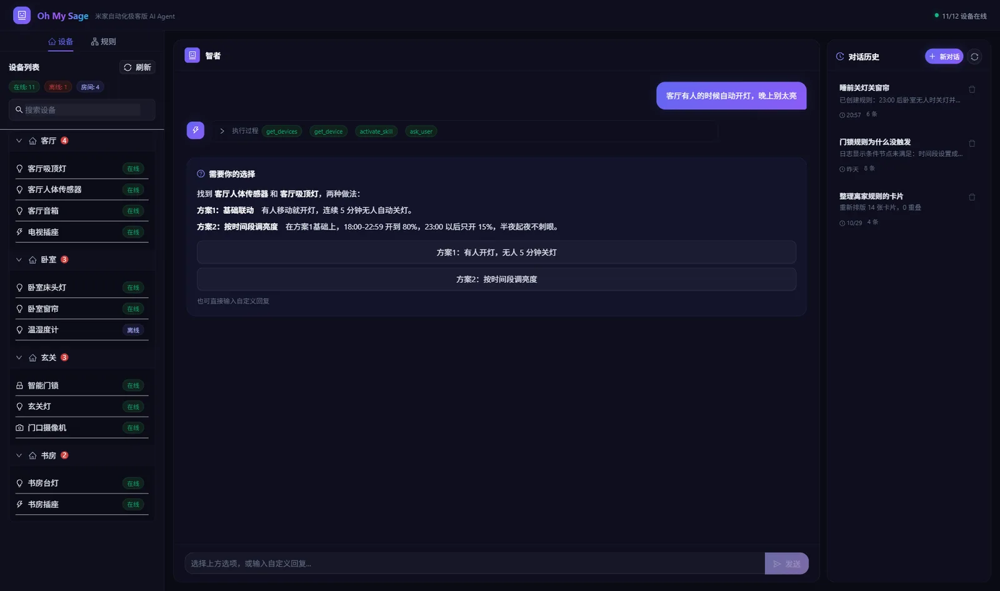

# 网页版

不用 AI Agent，在浏览器里直接聊。需要自己的大模型 API Key。



网页版要下载仓库运行，需要 [Git](https://git-scm.com/)：

```bash
git clone https://github.com/allocnode/oh-my-sage.git
cd oh-my-sage
npm install
cp .env.example .env    # Windows PowerShell：Copy-Item .env.example .env
```

编辑 `.env`，填好这四项：

```env
LLM_BASE_URL=https://api.deepseek.com/v1
LLM_MODEL=deepseek-flash
LLM_API_KEY=<你的 API Key>
GATEWAY_URL=http://<网关 IP>
```

| 服务商 | `LLM_BASE_URL` | `LLM_MODEL` 示例 |
|
